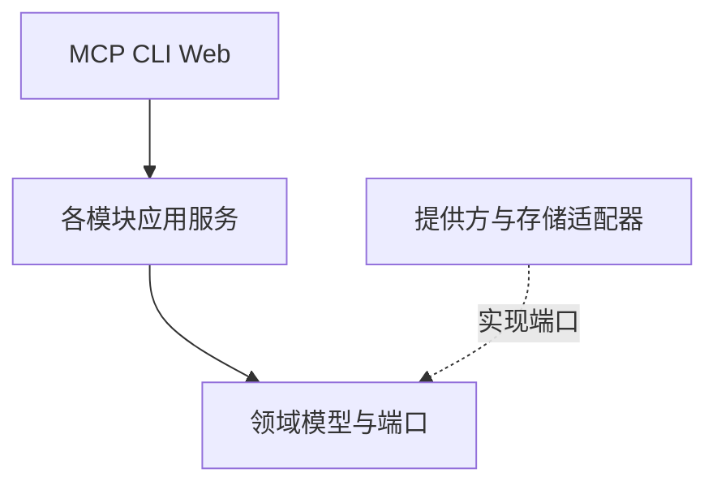
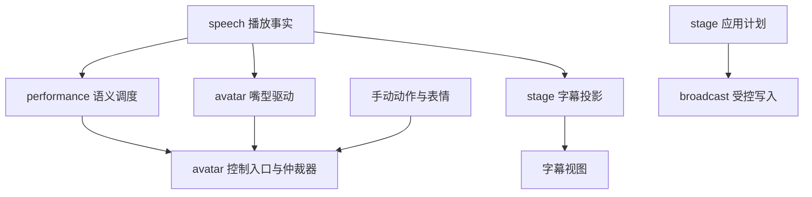

# 总体架构

本文面向模块实现者与技术评审，说明整体结构、状态所有权、依赖方向和内部协作方式。各专题在相应设计中展开。

采用本地优先的模块化单体。接入层处理协议，应用服务组织业务，领域模型维护规则，适配器连接第三方。启动入口负责装配和生命周期。

## 模块与状态所有权

| 模块 | 唯一写入的状态 | 公开能力 |
| --- | --- | --- |
| live_events | 平台事件、消费水位、过滤与触发规则、已决定的触发动作 | 接收、订阅、查询、规则管理 |
| speech | 语音配置、音色目录缓存、合成资源和播放队列 | 合成、播放、停止、播放事实和 PCM 包络 |
| transcription | 转写请求、输入资源引用和结果 | 提交、查询、取消 |
| avatar | VTS 连接、模型代际、输入映射、表情热键、嘴型配置及全部参数租约 | 能力发现、动作、参数仲裁和写入 |
| performance | 语义配置修订、关键词匹配和按播放位置调度的动作计划 | 保存映射、匹配、提交和撤销语义意图 |
| broadcast | OBS 连接、请求关联、目标资源写入锁和观察状态 | 查询、受控写入、结果回读 |
| stage | 展台编辑修订、组件与媒体引用、候选、应用计划、补偿记录和字幕视图 | 编辑、准备、应用、恢复、展示 |
| settings | 配置事务、修订登记、导入导出和凭据引用 | 调用业务模块校验和激活配置 |
| runtime | 实例生命周期、操作账、任务调度和取消信号 | 受理、查询、关闭和恢复调度 |

entrypoints、bootstrap 与 infrastructure 分别负责协议接入、模块装配和通用设施。制品维护与安全校验是跨模块职责，具体执行者在需求和专题设计中分配。

共享数据库不改变所有权。每个模块通过自己的存储接口读写状态；其他模块通过公开查询或事件取得信息。

## 身份与读取上下文

profile_id 标识运行配置，data_generation 标识其当前数据集。数据恢复切换生成新 data_generation，修订、事件水位和组件状态序列在对应代际内比较。runtime_status 提供当前上下文，变更请求携带该代际，查询与事件返回所属代际。

connection_id 标识一份连接配置，target_id 标识实际外部服务的协调域。连接注册根据已解析端点及适配器可取得的服务身份建立目标绑定；同一服务的连接别名复用 target_id 和写入协调器。连接代际表达一次连接实例，连接重建后重新核对目标身份。

avatar 的 model_id 是运行配置内唯一的内部模型身份，绑定 VTS 连接与 provider_model_id。模型加载代际独立于稳定 model_id，跨连接的同名或相同原生 ID 模型分别维护配置。指向同一 target_id 的连接别名共享当前模型加载代际及最终参数仲裁器，实际控制租约按目标、模型代际和输出参数身份协调。具体规则见[形象设计](../design/avatar-performance.md#模型与输入映射)。

各模块维护自己的可变列表版本投影。infrastructure 提供游标签名和快照租约存储，模块负责筛选、排序、摘要及版本提交；查询层按固定读取版本生成页面。详情查询返回当前对象，列表快照与详情通过对象身份和修订关联。

## 依赖方向



bootstrap 装配端口与适配器。上述箭头表示源码依赖；下图表示运行时事实与命令的流向。



所有 VTS 写入通过 avatar 的控制入口。performance 依赖该入口，avatar 不反向依赖 performance。语音提供方不认识语义映射、模型参数或 OBS。

settings 通过配置参与者接口请求校验和激活，不能直接修改模块内部字段。runtime 保存通用操作状态，完成判据由业务模块提供。stage 组织 OBS 应用流程，所有 OBS 写入仍经过 broadcast 的资源协调器。

## 事件与直接调用

需要返回值的命令使用公开应用接口。业务事实通过类型化事件发布。已保存事件、播放开始及终态、模型代际变化、修订变更使用持久化分发通道。播放进度和音量帧使用有界内存通道并保留最新值。停止和释放信号独立传递，消费者在断线、超时或重启后还需通过操作状态和租约代际完成清理。

订阅者仅处理自己的状态或提交公开命令。后台订阅失败由所属模块接收并报告，不沿回调链阻塞原始平台连接或播放器。接口、超时和恢复责任见[内部接口](interfaces.md)。

## 工程布局

```text
src/stagespirit_mcp/
  bootstrap/
  entrypoints/{mcp,cli,web}/
  modules/{live_events,speech,transcription,avatar,performance,broadcast,stage,settings}/
  runtime/
  infrastructure/{storage,secrets,logging}/
web/stage/
tests/{unit,contract,integration,e2e}/
```

业务模块按实际复杂度组织 models、application、ports 和 adapters。短模块可以合并文件；新抽象必须对应真实状态所有权或提供方差异。取舍见 [ADR 001](../adr/ADR-001-modular-runtime.md)。
